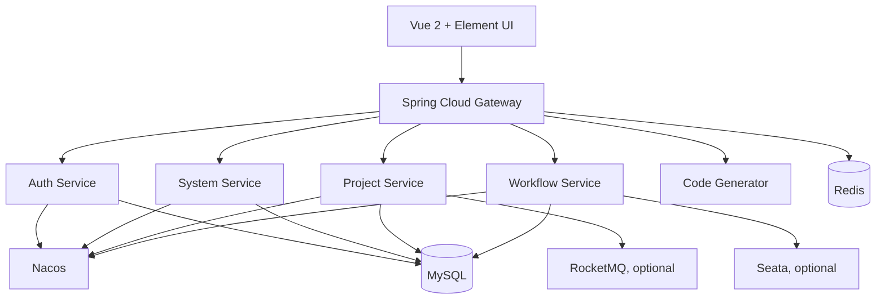

# PmHub

<p align="center">
  <strong>基于 Spring Cloud 的微服务项目管理与 BPM 工作流系统</strong>
</p>

<p align="center">
  
  
  
  
  
</p>

> **来源说明：** PmHub 原始项目由 [laigeoffer/pmhub](https://github.com/laigeoffer/pmhub) 发布。本仓库是独立托管的学习与实践副本，不代表上游项目的官方维护、发布或技术支持。原项目教程与版权归原作者及贡献者所有。

## 项目简介

PmHub 是一套面向项目管理场景的 Java 微服务系统，包含用户与权限、项目管理、BPM 工作流、代码生成和系统运维等模块。仓库同时保留单体版本和微服务版本，便于对比不同架构下的模块边界、服务治理和部署方式。

## 核心模块

- **项目管理：** 项目业务服务与相关管理功能。
- **BPM 工作流：** 流程设计、流程定义与业务流程处理。
- **认证与网关：** 独立认证服务、统一 API 网关和基础权限能力。
- **系统管理：** 用户、角色、菜单、部门、字典及系统配置等基础功能。
- **代码生成：** 根据数据表生成基础代码。
- **监控与运维：** 服务监控、任务调度及运行状态管理。
- **单体 / 微服务：** `pmhub-boot/` 保留单体项目；仓库根目录为微服务工程。

## 技术架构



## 技术栈

| 层次 | 技术 |
| --- | --- |
| 语言与构建 | Java 8、Maven |
| 后端框架 | Spring Boot 2.7.18、Spring Cloud 2021.0.8 |
| 微服务治理 | Spring Cloud Alibaba 2021.0.5.0、Nacos、Sentinel、Gateway、OpenFeign |
| 数据访问 | MyBatis、MySQL、Druid、PageHelper |
| 缓存与消息 | Redis、RocketMQ |
| 分布式事务 | Seata（按部署场景启用） |
| 前端 | Vue 2、Vue Router、Vuex、Element UI、Vue CLI |
| 运维与监控 | Docker、Nginx、Spring Boot Admin / SkyWalking（按需启用） |

版本信息来自仓库根目录 `pom.xml` 与 `pmhub-ui/package.json`。这是一个基于较早一代 Spring Cloud 技术栈的项目，升级到新版本前应先评估依赖兼容性。

## 仓库结构

```text
.
├── pmhub-gateway/       # 微服务网关
├── pmhub-auth/          # 认证服务
├── pmhub-base/          # 安全、事务、Swagger 等基础组件
├── pmhub-modules/       # system、project、workflow、job、gen 等业务服务
├── pmhub-api/           # 服务 API 与公共接口
├── pmhub-monitor/       # 监控模块
├── pmhub-boot/          # 单体版本
├── pmhub-ui/            # Vue 前端
├── sql/                 # 微服务数据库初始化脚本
├── docker/              # Docker 部署配置
├── docs/                # 环境、部署和配套教程
└── pom.xml              # Maven 聚合工程
```

## 环境准备

微服务版本通常需要：

- JDK 8
- Maven 3.8+
- MySQL
- Redis
- Nacos
- Node.js / npm（前端开发）
- RocketMQ、Sentinel、Seata、SkyWalking 等按需启用

不同模块使用独立数据库或 schema。请先阅读 SQL 文件说明和部署文档，再初始化数据库；不要直接把示例数据库密码、Nacos 默认账户或开发配置用于公网环境。

## 本地开发

### 后端

在仓库根目录构建微服务工程：

```bash
mvn clean install -DskipTests
```

然后按照配置中心、数据库和服务依赖顺序启动各个 Spring Boot 服务。每个服务的配置和启动类位于对应模块中。

### 前端

```bash
cd pmhub-ui
npm install
npm run serve
```

生产构建：

```bash
npm run build:prod
```

单体版本的独立说明见 [pmhub-boot/README.md](pmhub-boot/README.md)。

## 部署与学习文档

- [本地开发环境配置](docs/本地开发环境配置教程.md)
- [服务器启动教程](docs/服务器启动教程.md)
- [安装环境说明](docs/安装环境.md)
- [配套教程](docs/配套教程.md)
- [上游项目与完整教程](https://laigeoffer.cn/)
- [上游 GitHub 仓库](https://github.com/laigeoffer/pmhub)

## 使用说明

本仓库适合用于学习 Java 微服务拆分、服务注册发现、网关路由、配置管理、BPM 工作流和分布式基础设施。不要仅凭 README 中的技术组件列表就认定所有可选中间件已在本地启动；请以实际配置文件、部署文档和运行环境为准。

## 许可证

本仓库包含 MIT License，使用时请保留原项目版权与许可证声明。详见 [LICENSE](LICENSE)。
